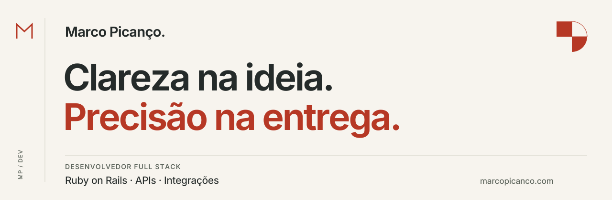

<picture>
  <source media="(prefers-color-scheme: dark)" srcset="assets/header-dark.svg">
  <source media="(prefers-color-scheme: light)" srcset="assets/header-light.svg">
  
</picture>

# Marco Picanço

**Desenvolvedor Full Stack · Ruby on Rails**

Desenvolvo aplicações web, APIs e integrações com atenção às regras de negócio,
aos testes e à manutenção. Na **OrçaFascio**, atuo na sustentação e evolução do
backoffice, conectando necessidades da operação a soluções em software.

Minha trajetória passou por vendas, sucesso do cliente e QA antes do
desenvolvimento. Essa experiência me ajuda a entender o problema, conversar com
quem usa o sistema e construir com contexto.

[Site e portfólio](https://www.marcopicanco.com) ·
[LinkedIn](https://www.linkedin.com/in/marcopicanco/) ·
[Contato por e-mail](mailto:marcopicanco.dev@gmail.com)

## Projetos selecionados

### [HexaAlerts](https://github.com/marcopicanco-dev/hexa_alerts)

Aplicação de portfólio para acompanhar partidas e eventos de futebol. Reúne
integração com APIs, processamento em segundo plano e atualizações na interface
com Hotwire.

**Ruby on Rails · PostgreSQL · Redis · Sidekiq · Hotwire**

### [Brasil Eleitoral](https://github.com/marcopicanco-dev/brasil-eleitoral)

Dashboard dos presidentes que governaram o país desde a redemocratização, em
1985. Reúne resultados eleitorais do TSE, inflação do IBGE e comparação entre
governos, com cada número rastreável até a fonte oficial.

**Ruby on Rails · PostgreSQL · Tailwind CSS · Hotwire · Docker**

### [Site e blog pessoal](https://github.com/marcopicanco-dev/marcopicanco-dev.github.io)

Meu espaço para apresentar serviços, registrar decisões técnicas e compartilhar
aprendizados. Site estático com conteúdo em MDX, identidade modernista e
verificações automatizadas no fluxo de publicação.

**Astro · TypeScript · MDX · GitHub Actions · GitHub Pages · Cloudflare**

## Ferramentas e práticas

- **Desenvolvimento:** Ruby, Ruby on Rails, JavaScript e SQL.
- **Dados e integrações:** PostgreSQL, MongoDB, APIs REST e webhooks.
- **Qualidade e ambiente:** testes com RSpec e Minitest, Git, Docker e Linux.

## Formação e interesses

Formação em Ciência da Computação, pós-graduação em Engenharia de Software e MBA
em Big Data. Tenho interesse em matemática, história e cultura, e gosto de
transformar o que aprendo em projetos e documentação.

---

**Visão de negócio. Cuidado com o código.**
